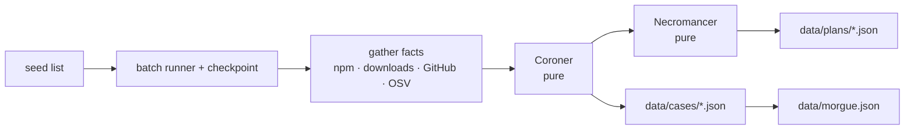

# Design Document: Morgue

## Overview

The Morgue is a three-stage pipeline: **gather** public facts, **diagnose** them with the Coroner, **prescribe** a repair plan with the Necromancer. Only the gather stage does I/O. Diagnosis and prescription are pure functions in `src/core/`, which is what lets us prove their behaviour with property-based tests.



## Architecture

| Layer | Folder | I/O? | Tested by |
|---|---|---|---|
| Shared helpers | `src/core/shared/` | no | unit + property |
| Coroner | `src/core/coroner/` | no | unit + property |
| Necromancer | `src/core/necromancer/` | no | unit + property |
| Sources | `src/pipeline/sources/` | yes (fetch injected) | fixture tests |
| Batch runner | `src/pipeline/batch.ts` | via injected functions | property |
| Writers | `src/pipeline/write.ts` | file system | unit (temp dir) |
| CLI | `src/cli.ts` | yes | smoke test |

## Components and Interfaces

### Shared (`src/core/shared/`)

```ts
// file-key.ts
export function toFileKey(packageName: string): string;   // "@scope/name" -> "@scope__name"
export function fromFileKey(key: string): string;         // inverse
// time.ts
export function daysBetween(fromIso: string, toIso: string): number; // whole days, floor, >= 0
export function monthsBetween(fromIso: string, toIso: string): number; // days / 30.44, 2 decimals
```

File key rules: npm names may contain `a-z 0-9 - . _ ~` and one `/` after a leading `@scope`. Legacy names may also contain uppercase letters (e.g. `JSONStream`). Steps:
1. Replace `/` with `__`.
2. Encode each uppercase letter as `^` followed by its lowercase form (`JSONStream` → `^j^s^o^n^stream`), so keys stay unique on case-insensitive file systems (Windows, macOS).
3. Prefix Windows reserved names (`con`, `prn`, `aux`, `nul`, `com1`–`com9`, `lpt1`–`lpt9`) with `^_` (a marker no real name can produce, so `_con` and `con` never collide).
Reject (throw) names containing `^`, a `__` sequence, or characters outside the allowed set, so the mapping stays reversible.

### Coroner (`src/core/coroner/`)

```ts
export type Known<T> = { value: T; source: string };
export type Fact<T> = Known<T> | { value: null; source: null }; // null = unknown

export interface Vuln { id: string; summary: string; severity: 'LOW'|'MODERATE'|'HIGH'|'CRITICAL'|'UNKNOWN'; fixedIn: string | null; url: string }

export interface Facts {
  name: string;
  ecosystem: 'npm';
  latestVersion: Fact<string>;
  lastReleaseAt: Fact<string>;          // ISO date of latest version
  weeklyDownloads: Fact<number>;
  publishers: Fact<number>;             // npm maintainers count
  deprecated: Fact<string | false>;     // deprecation message, or false
  repoUrl: Fact<string>;
  repoMissing: Fact<boolean>;
  archived: Fact<boolean>;
  lastHumanCommitAt: Fact<string>;
  openIssuesAndPrs: Fact<number>;
  vulns: Fact<Vuln[]>;
}

export type Verdict = 'ALIVE' | 'RESTING' | 'DORMANT' | 'DEAD';
export type CauseCode = 'ARCHIVED'|'REPO_MISSING'|'NPM_DEPRECATED'|'ABANDONED'|'STALE'|'UNPATCHED_VULN'|'ISSUE_PILEUP'|'SINGLE_KEYHOLDER';
export interface Evidence { label: string; value: string; source: string }
export interface Cause { code: CauseCode; summary: string; evidence: Evidence[] }

export interface CaseFile {
  name: string; fileKey: string; verdict: Verdict; confidence: 'full' | 'partial';
  causes: Cause[]; risk: number; timeOfDeath: string | null;
  ageSignal: 'last_human_commit' | 'last_release' | 'none';
  facts: Facts; scannedAt: string; rulesVersion: '1';
}

export function diagnose(facts: Facts, nowIso: string): CaseFile;
export const VERDICT_RANK: Record<Verdict, number> = { ALIVE: 0, RESTING: 1, DORMANT: 2, DEAD: 3 };
```

#### Rules (rulesVersion 1)

Constants: `STALE_MONTHS = 12`, `ABANDONED_MONTHS = 24`, `PILEUP_OPEN = 50`.

Age signal: `lastHumanCommitAt` if known, else `lastReleaseAt` if known, else none.

| Cause | Fires when |
|---|---|
| `ARCHIVED` | `archived` is true |
| `REPO_MISSING` | `repoMissing` is true |
| `NPM_DEPRECATED` | `deprecated` is a non-empty string |
| `ABANDONED` | age ≥ 24 months |
| `STALE` | 12 ≤ age < 24 months |
| `UNPATCHED_VULN` | at least one vuln affects the latest version |
| `ISSUE_PILEUP` | open issues + PRs ≥ 50 AND age ≥ 12 months |
| `SINGLE_KEYHOLDER` | publishers = 1 |

Derived flags: `terminal = ARCHIVED ∨ REPO_MISSING ∨ NPM_DEPRECATED`, `harm = UNPATCHED_VULN ∨ ISSUE_PILEUP`.

| Verdict | Condition (first match wins) |
|---|---|
| DEAD | `terminal` ∨ (`ABANDONED` ∧ `harm`) |
| DORMANT | `STALE` ∧ `harm` |
| RESTING | (`ABANDONED` ∨ `STALE`) ∧ ¬`harm` |
| ALIVE | otherwise |

`SINGLE_KEYHOLDER` never changes the verdict, only the risk. `confidence = 'partial'` when any of `archived`, `repoMissing`, `deprecated`, `vulns`, `openIssuesAndPrs` or the age signal is unknown.

#### Risk

```
weight   = { ALIVE: 0, RESTING: 0.2, DORMANT: 0.6, DEAD: 1 }[verdict]
reach    = log10(1 + weeklyDownloads)            // 0 if unknown
keys     = SINGLE_KEYHOLDER ? 1.5 : 1
severity = CRITICAL ? 1.5 : HIGH ? 1.3 : 1        // worst unpatched vuln
risk     = round1(weight × reach × keys × severity)
```

#### Plain-language summaries

Each cause has a fixed summary template, e.g. `ABANDONED`: "No human commit for {months} months (since {date})." Templates live in `src/core/coroner/summaries.ts` and follow `voice.md`.

### Necromancer (`src/core/necromancer/`)

```ts
export interface PlanRequirement { id: string; title: string; story: string; criteria: string[] } // id "1", "2"…
export interface PlanTask { id: string; title: string; details: string[]; refs: string[]; optional?: boolean } // id "1", "1.1"; refs "2.1"
export interface Plan { packageName: string; slug: string; requirements: PlanRequirement[]; design: { title: string; body: string }[]; tasks: PlanTask[]; steering: string }
export type PlanResult = { kind: 'plan'; plan: Plan } | { kind: 'not_needed'; note: string };

export function prescribe(caseFile: CaseFile): PlanResult;
export function renderPlan(plan: Plan): Record<string, string>;   // path -> file contents
export function parsePlan(files: Record<string, string>): { requirementCriteriaIds: string[]; taskRefs: string[][] };
export const EARS: RegExp;
```

`EARS` accepts one sentence matching one of: `WHEN …, THE … SHALL …` · `IF …, THEN THE … SHALL …` · `WHILE …, THE … SHALL …` · `WHERE …, THE … SHALL …` · `THE … SHALL …` (with optional `NOT` after `SHALL`).

#### Cause → plan mapping

Every plan starts with **Requirement 1: Baseline** ("WHEN the revived package is installed on Node 18, 20 or 22, THE package SHALL pass its existing test suite.") and tasks: fork, run tests, record the baseline, add a CI matrix.

| Cause | Requirement added | Tasks added |
|---|---|---|
| `NPM_DEPRECATED` with replacement | "Prefer migration" (placed first) | Compare APIs, write a migration note, decide revive vs migrate |
| `NPM_DEPRECATED` without replacement | "Explain the deprecation" | Read the deprecation message, document what changes |
| `ARCHIVED` / `REPO_MISSING` | "Continue under a clear new home" | Fork under a new scope, write `MIGRATION.md`, request transfer through the registry's own process |
| `ABANDONED` / `STALE` | "Modern runtime support" | Update dev tooling, fix test failures, publish a patch release |
| `UNPATCHED_VULN` (one per vuln) | "Not affected by {id}" | Find the affected path, upgrade to `fixedIn` or patch, add a regression test |
| `ISSUE_PILEUP` | "Triage open issues" | Label, close duplicates, answer the top 10 by reactions |
| `SINGLE_KEYHOLDER` | "At least two keyholders" | Add a second maintainer, commit a `GRAVEKEEPER.json` will |

`revival.md` steering: keep the public API stable, follow semver, add tests before changes, no new runtime dependencies without a written reason, credit the original authors.

Slug: `toFileKey(name)` lowercased with `@` removed and `__` replaced by `-`.

### Sources (`src/pipeline/sources/`)

```ts
export type FetchJson = (url: string, init?: RequestInit) => Promise<{ status: number; json: unknown; headers: Headers }>;
export function makeHttp(opts: { userAgent: string; delayMs: number; retries: 3; token?: string }): FetchJson;
export async function npmFacts(name: string, http: FetchJson): Promise<Partial<Facts>>;
export async function downloadsBulk(names: string[], http: FetchJson): Promise<Map<string, Fact<number>>>;
export async function githubFacts(repoUrl: string, http: FetchJson): Promise<Partial<Facts>>;
export async function osvFacts(pkgs: { name: string; version: string }[], http: FetchJson): Promise<Map<string, Fact<Vuln[]>>>;
export async function seedFromEcosystems(limit: number, http: FetchJson): Promise<string[]>;
export function seedFromFile(text: string): string[];
```

- Repository URL normalisation handles `git+https://`, `git://`, `ssh://git@`, `github:owner/repo` and trailing `.git`. Non-GitHub hosts → `repoUrl` known, other GitHub facts unknown.
- OSV: one `querybatch` per batch; fetch vuln details only for ids returned; cache details by id for the run.
- HTTP: retries on 429 and 5xx; honours `Retry-After` (seconds or HTTP date); never retries 404.

### Batch runner (`src/pipeline/batch.ts`)

```ts
export interface Checkpoint { seedHash: string; completedBatches: number; batchSize: number }
export async function runBatches<T>(opts: {
  seed: string[]; batchSize: number;
  loadCheckpoint(): Promise<Checkpoint | null>;
  saveCheckpoint(c: Checkpoint): Promise<void>;
  processBatch(names: string[]): Promise<T[]>;
  writeBatch(results: T[]): Promise<void>;
}): Promise<{ processed: number; batches: number }>;
```

The checkpoint is ignored if `seedHash` or `batchSize` differ (new seed = new scan). `writeBatch` runs before `saveCheckpoint`, and case files are keyed by name, so re-running a half-written batch overwrites rather than duplicates.

### Writers (`src/pipeline/write.ts`)

- `data/cases/<key>.json` — full `CaseFile`.
- `data/plans/<key>.json` — `renderPlan()` output as `{ files: Record<path, string> }`.
- `data/morgue.json` — `{ scannedAt, sources, rulesVersion, totals: { examined, ALIVE, RESTING, DORMANT, DEAD, deadWeeklyDownloads }, rows: SummaryRow[] }`, rebuilt from all case files at the end so it is always consistent.

## Data Models

`SummaryRow = { name, fileKey, verdict, risk, weeklyDownloads: number | null, timeOfDeath: string | null, causes: CauseCode[] }`, sorted by risk descending, then name.

## Correctness Properties

*A property is a statement that must hold for every valid input. Each one below is implemented as a fast-check test.*

### Property 1: Every cause has evidence
*For any* facts and time, every cause in `diagnose(facts, now).causes` has at least one evidence item, and every evidence item has a non-empty `source`.
**Validates: Requirements 1.2, 2.2**

### Property 2: Verdict follows the rule table
*For any* facts and time, the verdict equals the first matching row of the verdict table computed independently from the cause set; in particular terminal causes always give DEAD and age without harm never gives DEAD.
**Validates: Requirements 2.1, 2.3, 2.4**

### Property 3: Age never improves a verdict
*For any* facts and two scan times `t1 ≤ t2` (all other facts equal), `VERDICT_RANK[diagnose(f, t2).verdict] ≥ VERDICT_RANK[diagnose(f, t1).verdict]`.
**Validates: Requirements 2.1, 2.3**

### Property 4: Determinism
*For any* facts and time, `diagnose` and `prescribe` return deeply equal results when called twice, and do not mutate their input.
**Validates: Requirements 2.5, 3.6**

### Property 5: Risk is sane
*For any* facts, risk is 0 when the verdict is ALIVE, and increasing weekly downloads (all else equal) never lowers risk.
**Validates: Requirement 2.8**

### Property 6: Unknown facts are never evidence
*For any* facts where a field is unknown, no evidence item cites that field, and confidence is `partial` if the field is one the rules depend on.
**Validates: Requirements 2.6, 2.7**

### Property 7: Plans cover every cause
*For any* DORMANT or DEAD case file, each cause code appears in at least one requirement and one task of the plan.
**Validates: Requirements 3.1, 3.2**

### Property 8: Plans are valid Kiro specs
*For any* DORMANT or DEAD case file, every acceptance criterion in `renderPlan(plan)` matches `EARS`, and every `_Requirements:_` reference in `tasks.md` names a criterion that exists in `requirements.md`.
**Validates: Requirements 3.3, 3.4**

### Property 9: Render/parse round trip
*For any* plan, `parsePlan(renderPlan(plan))` returns the plan's criterion ids and task references unchanged.
**Validates: Requirements 3.3, 3.4**

### Property 10: File keys round trip safely
*For any* valid npm package name `n` (including scoped and legacy mixed-case names), `fromFileKey(toFileKey(n)) === n`, the key matches `/^[@a-z0-9._~^-]+$/`, and distinct names give keys that stay distinct even when compared case-insensitively.
**Validates: Requirement 5.2**

### Property 11: Batches run exactly once
*For any* seed list, batch size, and crash point (an exception thrown in `processBatch` or `writeBatch` at a random batch), running `runBatches` until it completes writes exactly one result per seed name, with no duplicates and no gaps.
**Validates: Requirements 4.1, 4.2, 4.3**

## Error Handling

- Source failures become unknown facts, never thrown errors, so one bad package never stops a scan.
- `diagnose` and `prescribe` never throw for valid `Facts`; invalid input fails zod validation at the pipeline boundary.
- The CLI prints one-line, plain-language errors and a hint, never a stack trace (unless `--debug`).

## Testing Strategy

- **Property tests** (`*.prop.test.ts`): Properties 1–11. Generators: `arbFacts` (every field independently known or unknown, dates 2012–2026, downloads 0–10⁹, 0–5 vulns), `arbNow` (after all generated dates), `arbPackageName` (scoped and unscoped valid npm names).
- **Example tests**: four hand-written fixture packages, one per verdict, with expected case files checked into `tests/fixtures/cases/`.
- **Fixture tests for sources**: recorded JSON for one healthy and one dead package from each API, including a 404, a 429 with `Retry-After`, and a bot-only commit page.
- **Smoke test**: `gk case <fixture>` prints a verdict line.
