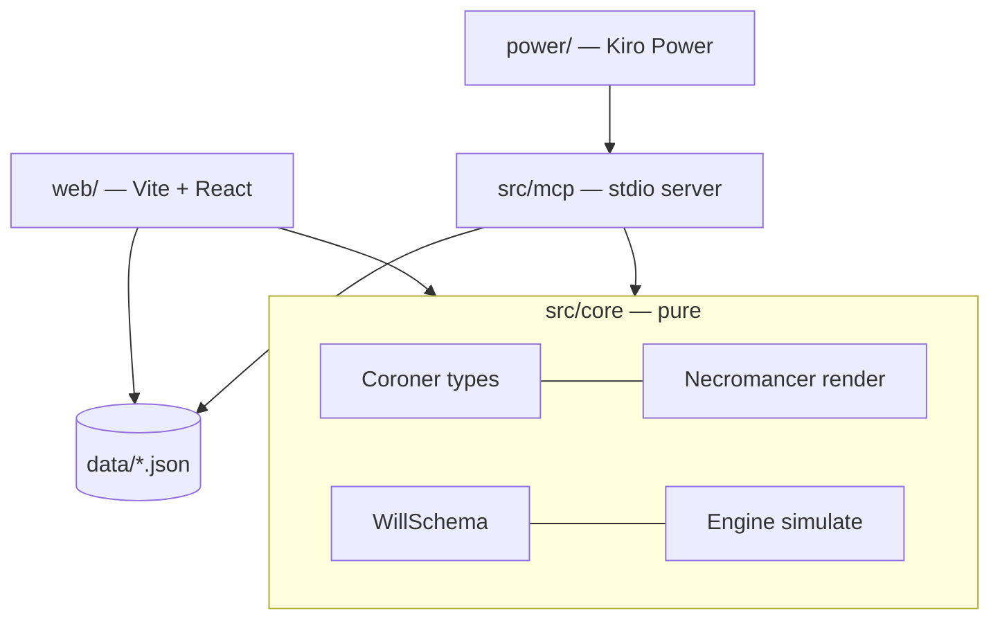

# Design Document: Surfaces

## Overview

Three surfaces share one core:



## Site (`web/`)

### Pages and routes (HashRouter)

| Route | Page | Data |
|---|---|---|
| `#/` | Home | `morgue.json` |
| `#/morgue?verdict=&q=&sort=` | Morgue list | `morgue.json` |
| `#/case/:fileKey` | Case page | `cases/<key>.json`, `plans/<key>.json` |
| `#/will` | Will writer | none |
| `#/will/demo` | Will demo | none (engine runs in the browser) |
| `#/registry` | Registry | `registry.json` |
| `#/about` | Method and credits | `morgue.json` (sources, rules version) |

### Components

- `Layout`: header (wordmark "Gravekeeper", nav), footer (credits, Kiro, MIT, repo link).
- `Intern`: inline SVG mascot plus a speech line. Props: `line`, `size`. Used only in loading, empty and error states and on Home.
- `Stamp`: verdict word in a rubber-stamp style (border, rotated −4°, slightly uneven opacity). Colours from `voice.md`.
- `CaseFolder`: manila folder card with a tab, `ToeTag` (package name), stamp and key facts.
- `DeathCertificate`: two-column bordered layout with typewriter data fields, used on the Case page.
- `EvidenceList`: cause summary followed by evidence rows (label, value, source link).
- `PlanPreview`: file tabs (`requirements.md`, `design.md`, `tasks.md`, `revival.md`) with a monospace viewer, a "Download as zip" button (JSZip, filename `revive-<slug>.zip`), and three numbered steps for Kiro.
- `WillForm`: controlled form; validation via `parseWill`; list inputs for heirs and witnesses; sensible defaults (quorum 2, silence 180, grace 30, window 30).
- `SignedWill`: the JSON shown on paper with a signature line ("Signed in Git by @maintainer"), plus copy, download and register buttons.
- `WillDemo`: controls plus a `Timeline` (log entries) and `CommentFeed` (effects rendered with the real messages from `src/core/succession/messages.ts`).
- `LetterView`: renders the handover letter markdown (a tiny safe markdown renderer, no raw HTML).

### Data loading

`web/src/data.ts` exports `useJson<T>(path)` with an in-memory cache, `loading | error | ready` states and a retry function. At build time, `scripts/copy-data.mjs` copies `data/` into `web/public/data/`.

### Register link

`registerIssueUrl(repoUrl)` builds `https://github.com/<owner>/gravekeeper/issues/new?template=register-will.yml&title=Register+will:+<repo>&repo_url=<encoded>`. The will itself lives in the maintainer's repo, so the URL stays short.

### Demo script

`demoWill` (three witnesses, quorum 2, silence 180, grace 30, window 30) and a default script: activity on day 0, 40 and 90, then silence, ticks every day. User buttons inject events at the current simulated time. The demo calls `simulate()` and renders each step; nothing is re-implemented in the UI.

### Visual design

Tokens in `web/src/styles/tokens.css` from `voice.md` (paper, manila, ink, stamp red, amber, slate, green). Fonts: Fraunces (headings), Inter (body), IBM Plex Mono (case data), self-hosted with `font-display: swap`. Paper texture via a tiny CSS gradient, no images. Motion: stamps "thunk" in with a 120 ms scale animation, disabled under `prefers-reduced-motion`.

## MCP server (`src/mcp/server.ts`)

```ts
// tools (zod input schemas)
get_case({ name: string }) -> text summary + JSON CaseFile
get_repair_plan({ name: string }) -> { files: Record<path, string> } or "no revival needed" note
check_dependencies({ package_json: string }) -> list of { name, verdict, topCause, caseUrl } for DORMANT/DEAD deps
```

- `DataSource` interface with `localData(dir)` and `remoteData(baseUrl)`; chosen by `GRAVEKEEPER_DATA_DIR` / `GRAVEKEEPER_DATA_URL` (default: the published site).
- Dependencies are read from `dependencies`, `devDependencies`, `peerDependencies` and `optionalDependencies`; duplicates counted once.
- Output text follows `voice.md`: facts, not blame.

## Kiro Power (`power/`)

```
power/
├── plugin.json                     manifest: name "gravekeeper", description, activation keywords
│                                   (dead dependency, abandoned package, unmaintained, revive package, succession)
├── mcp.json                        runs `npx -y github:<owner>/gravekeeper` (bin `gravekeeper-mcp`) with GRAVEKEEPER_DATA_URL;
│                                   installing from GitHub means no npm publish is needed (a `prepare` script builds dist/)
└── skills/check-dependencies/
    ├── SKILL.md                    when to call which tool; how to present results; offer the repair plan
    └── references/verdicts.md      what ALIVE / RESTING / DORMANT / DEAD mean
```

Before writing `plugin.json`, read Kiro's current Powers documentation (kiro.dev/docs/powers) and follow its exact field names. Note any differences from this design in `KIRO_LOG.md`.

## Pages workflow (`.github/workflows/pages.yml`)

On push to `main` and on `workflow_dispatch`: checkout, `npm ci`, `npm run web:build` (which runs `copy-data.mjs` first), upload `web/dist` with `actions/upload-pages-artifact`, deploy with `actions/deploy-pages`. `permissions: { contents: read, pages: write, id-token: write }`, `concurrency: pages`.

## Correctness Properties

### Property S1: The form and the schema agree
*For any* valid will `w`, filling the form from `w` and reading it back produces `w` (round trip), and the form reports "valid" exactly when `parseWill` returns `ok: true`.
**Validates: Requirements 5.1, 5.2**

### Property S2: Register links are well-formed
*For any* GitHub repository URL, `registerIssueUrl` returns a URL under 2,000 characters whose `repo_url` parameter decodes back to the input.
**Validates: Requirement 5.3**

### Property S3: Dependency checks are exact
*For any* generated morgue (rows with random verdicts) and any `package.json` whose dependency maps mix morgue and non-morgue names, `check_dependencies` returns exactly the names whose verdict is DORMANT or DEAD, each once.
**Validates: Requirement 8.3**

### Property S4: The zip is the plan
*For any* rendered plan, the zip built by `PlanPreview` contains exactly the paths and contents of `renderPlan(plan)`.
**Validates: Requirement 4.3**

### Property S5: The demo is the engine
*For any* demo script, the phases shown by `WillDemo`'s state reducer equal the phases from `simulate(demoWill, script)` step by step.
**Validates: Requirements 6.1, 6.3**

## Error Handling

- Missing case or plan file → "The Intern can't find this file" state with a link back to the Morgue.
- Invalid `package.json` passed to MCP → a plain error naming the JSON problem.
- Remote data fetch failure in MCP → error text suggesting `GRAVEKEEPER_DATA_DIR`.

## Testing Strategy

- Property tests S1–S5 (200 runs each) with Vitest + fast-check. UI logic is kept in plain functions (`formToWill`, `willToForm`, `registerIssueUrl`, `buildZip`, `demoReducer`) so the properties test logic, not the DOM.
- A few component tests with `@testing-library/react` only if time allows (optional).
- Manual checks before submission: 375 px layout, keyboard-only navigation, reduced motion, Lighthouse accessibility ≥ 95.
