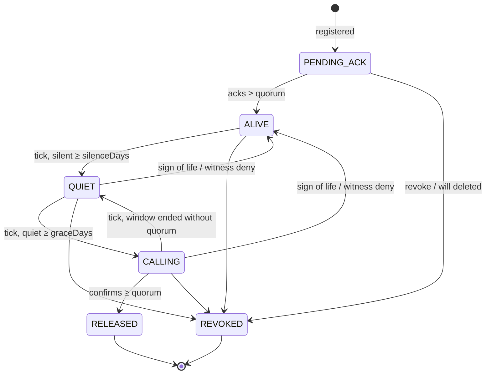

# Design Document: Will

## Overview

The Will has a pure core and a thin GitHub shell.

- **Core** (`src/core/succession/`): the will schema, the succession engine (a state machine folded over timestamped events), and the letter renderer. No I/O. Property-tested with 1,000 runs per property.
- **Shell** (`src/registry/`): reads wills and comments from GitHub, turns them into events, runs the engine, then carries out the effects (comments, files, closing threads). Runs inside GitHub Actions with this repo's `GITHUB_TOKEN`.



## Components and Interfaces

### Will schema (`src/core/succession/will.ts`)

```ts
export const WillSchema = z.object({
  version: z.literal(1),
  maintainer: GitHubLogin,
  packages: z.array(z.object({ registry: z.literal('npm'), name: z.string() })).min(1).max(20),
  heirs: z.array(GitHubLogin).min(1).max(5),
  witnesses: z.array(GitHubLogin).min(2).max(7),
  quorum: z.number().int().min(2),
  silenceDays: z.number().int().min(90).max(730),
  graceDays: z.number().int().min(7).max(90),
  witnessWindowDays: z.number().int().min(7).max(90),
  message: z.string().max(2000).optional(),
}).superRefine(/* quorum ≤ witnesses.length; no person in two roles (case-insensitive); no duplicates in a list */);
export type Will = z.infer<typeof WillSchema>;
export function parseWill(json: unknown): { ok: true; will: Will } | { ok: false; errors: string[] }; // plain-language errors
```

`GitHubLogin`: 1–39 chars, alphanumeric or single hyphens, no leading or trailing hyphen; normalised to lowercase for comparisons, original casing kept for display.

### Engine (`src/core/succession/engine.ts`)

```ts
export type Phase = 'PENDING_ACK' | 'ALIVE' | 'QUIET' | 'CALLING' | 'RELEASED' | 'REVOKED';
export type Command = 'ack' | 'alive' | 'confirm' | 'deny' | 'revoke';

export type WillEvent =
  | { type: 'tick'; at: string }
  | { type: 'data_unavailable'; at: string }
  | { type: 'activity'; at: string; ref?: string }              // public GitHub event by the maintainer
  | { type: 'command'; at: string; author: string; command: Command; ref?: string }
  | { type: 'will_removed'; at: string };

export type Effect =
  | { type: 'post_checkin' } | { type: 'post_welcome_back' } | { type: 'call_witnesses' }
  | { type: 'post_call_expired' } | { type: 'publish_letter' } | { type: 'notify_heirs' }
  | { type: 'close_thread' } | { type: 'ask_witnesses_to_ack' };

export interface LogEntry { at: string; from: Phase; to: Phase; cause: string; actor: string | null; ref?: string }

export interface WillState {
  phase: Phase;
  registeredAt: string;
  lastSignOfLifeAt: string;
  acked: string[];                 // lowercase logins, sorted
  quietSince: string | null;
  callStartedAt: string | null;
  confirmations: string[];         // lowercase logins, sorted, current call only
  releasedAt: string | null;
  log: LogEntry[];
  ignored: { at: string; author: string; command: string }[];
}

export function initialState(registeredAt: string): WillState;  // PENDING_ACK, lastSignOfLifeAt = registeredAt
export function step(will: Will, state: WillState, event: WillEvent): { state: WillState; effects: Effect[] };
export function run(will: Will, state: WillState, events: WillEvent[]): { state: WillState; effects: Effect[] };
export function simulate(will: Will, script: WillEvent[]): { state: WillState; effects: Effect[]; event: WillEvent }[];
```

`run` sorts events by a total order before folding: `at` ascending, then type (`will_removed`, `activity`, `command`, `data_unavailable`, `tick`), then author, then command, then `ref`. Sorting makes the result independent of input order (Property W7). Duplicate events (same fields) are dropped.

#### Transition rules

Who counts: `alive` and `revoke` only from the maintainer. `ack` only from a listed witness. `confirm` and `deny` only from an acknowledged witness. Anything else is appended to `ignored` and changes nothing.

| Phase | Event | Result |
|---|---|---|
| any terminal | anything | no change |
| any non-terminal | `revoke` by maintainer, or `will_removed` | → `REVOKED`, `close_thread` |
| `PENDING_ACK` | `ack` by witness | add to `acked`; if `acked ≥ quorum` → `ALIVE` |
| `PENDING_ACK` | activity / `alive` | update `lastSignOfLifeAt` |
| `ALIVE` | activity / `alive` | update `lastSignOfLifeAt` |
| `ALIVE` | `tick` with `days(lastSignOfLifeAt, at) ≥ silenceDays` | → `QUIET`, `quietSince = at`, `post_checkin` |
| `QUIET` | activity / `alive` | → `ALIVE`, update `lastSignOfLifeAt`, `post_welcome_back` |
| `QUIET` | `deny` | → `ALIVE`, `lastSignOfLifeAt = at`, `post_welcome_back` |
| `QUIET` | `tick` with `days(quietSince, at) ≥ graceDays` | → `CALLING`, `callStartedAt = at`, `confirmations = []`, `call_witnesses` |
| `CALLING` | activity / `alive` / `deny` | → `ALIVE` (as in `QUIET`) |
| `CALLING` | `confirm` with `at < callStartedAt + witnessWindowDays` | add to `confirmations`; if `≥ quorum` → `RELEASED`, `releasedAt = at`, `publish_letter`, `notify_heirs`, `close_thread` |
| `CALLING` | `confirm` outside the window | ignored (logged) |
| `CALLING` | `tick` with `days(callStartedAt, at) ≥ witnessWindowDays` | → `QUIET`, `quietSince = at`, `post_call_expired`, `post_checkin` |
| any | `data_unavailable` | no change (logged as a skipped tick) |

`lastSignOfLifeAt` only moves forward (`max`). Days use `daysBetween` from `src/core/shared/time.ts`.

### Letter (`src/core/succession/letter.ts`)

```ts
export function renderLetter(input: { id: string; will: Will; state: WillState; repoUrl: string; threadUrl: string; planUrls: Record<string, string> }): string;
```

Sections: title, what this letter is (and is not), the maintainer's message (quoted verbatim), heirs, packages with repair-plan links, timeline (every log entry with links), witnesses who confirmed, how to use this letter (link to npm's and GitHub's own transfer processes). Follows `voice.md` safety tone: serious, no jokes, no mascot.

### Registry shell (`src/registry/`)

```ts
export interface RegistryIO {
  readWillFile(repo: string): Promise<{ json: unknown; lastCommitAuthor: string | null } | 'missing' | 'unavailable'>;
  maintainerActivity(login: string, sinceIso: string): Promise<{ at: string; ref: string }[] | 'unavailable'>;
  threadComments(threadNumber: number, sinceIso: string): Promise<{ at: string; author: string; body: string; url: string }[] | 'unavailable'>;
  postComment(threadNumber: number, body: string): Promise<void>;
  closeThread(threadNumber: number): Promise<void>;
  readJson<T>(path: string): Promise<T | null>;
  writeJson(path: string, value: unknown): Promise<void>;
  writeText(path: string, text: string): Promise<void>;
}
export function parseCommand(body: string): Command | null; // first line only, exactly "/ack", "/alive", "/confirm", "/deny" or "/revoke"
export async function registerWill(io: RegistryIO, issue: { number: number; body: string; author: string }, nowIso: string): Promise<void>;
export async function tickWill(io: RegistryIO, id: string, nowIso: string): Promise<void>;
export async function tickAll(io: RegistryIO, nowIso: string): Promise<void>;
```

- `githubIO(token)` implements `RegistryIO` with `fetch` against the GitHub REST API. Activity comes from `GET /users/{login}/events/public` (covers the last 90 days; daily ticks mean we never miss a window). The will author check uses `GET /repos/{owner}/{repo}/commits?path=GRAVEKEEPER.json&per_page=1`.
- `fakeIO()` is an in-memory implementation for tests.
- Messages (check-in, welcome back, witness call, call expired, release) live in `src/core/succession/messages.ts` (pure functions, so the website demo shows the exact same text), written per `voice.md`, each one explaining exactly what will happen next and when.
- Per-will state lives in `registry/state/<id>.json`, including `threadNumber` and `lastTickAt`. `tickWill` builds events from data since `lastTickAt`, appends a `tick` (or `data_unavailable` if any fetch failed), runs the engine, performs effects, then writes state. Effects are idempotent: the state is written after each effect, and each effect is recorded, so a crashed run never double-posts.
- `exportRegistry()` writes `data/registry.json`.

### Workflows

- `.github/ISSUE_TEMPLATE/register-will.yml`: form with one field (repository URL) and the `register-will` label.
- `.github/workflows/wills.yml`: triggers `issues: [opened]`, `issue_comment: [created]`, daily `schedule`, `workflow_dispatch`. `permissions: { contents: write, issues: write }`. `concurrency: { group: wills, cancel-in-progress: false }`. Runs `npm ci` then `npm run gk -- wills register|tick|tick-all`, then commits `registry/` and `data/registry.json`.

## Correctness Properties

### Property W1: No release while the maintainer is alive
*For any* valid will and event list, if the final phase is `RELEASED` at `releasedAt`, then every maintainer sign of life (activity or `/alive`) before `releasedAt` is at least `silenceDays + graceDays` days earlier.
**Validates: Requirements 4.2, 5.1, 6.1**

### Property W2: Release needs a real quorum
*For any* valid will and event list ending in `RELEASED`, at least `quorum` distinct acknowledged witnesses issued `/confirm` after the last `call_witnesses` and inside the witness window.
**Validates: Requirements 6.2, 7.1**

### Property W3: Release happens once and is final
*For any* valid will and event list, `publish_letter` appears at most once in the effects, and once the phase is `RELEASED` or `REVOKED` it never changes.
**Validates: Requirements 7.4, 8.2**

### Property W4: Strangers cannot move a will
*For any* valid will and event list, adding commands from authors who are neither the maintainer nor a witness leaves the final phase, `acked`, `confirmations` and effects unchanged.
**Validates: Requirement 9.1**

### Property W5: Revocation wins
*For any* valid will and event list containing a maintainer `/revoke` (or `will_removed`) before any release, the final phase is `REVOKED`.
**Validates: Requirement 8.1**

### Property W6: Missing data never moves a will forward
*For any* valid will, state and time, `step` with a `data_unavailable` event leaves every field except `log` unchanged and emits no effects; and *for any* event list with no `tick` events, the final phase is never `QUIET`, `CALLING` or `RELEASED`.
**Validates: Requirements 4.3, 9.4**

*Design note:* we deliberately do **not** claim "dropping ticks can never cause a release". A delayed witness call can shift the witness window later, so confirmations that were too late for the original call can be valid for the delayed one. That is acceptable: W1 and W2 still guarantee the silence, grace period and a fresh quorum.

### Property W7: Order does not matter
*For any* valid will and event list, `run` on any permutation of the list returns a deeply equal state and effect list.
**Validates: Requirement 9.4**

### Property W8: Any sign of life resets
*For any* valid will in `QUIET` or `CALLING`, a maintainer activity, `/alive`, or acknowledged-witness `/deny` event moves it to `ALIVE`.
**Validates: Requirements 5.2, 5.3**

### Property W9: The schema guards the roles
*For any* object accepted by `WillSchema`, `2 ≤ quorum ≤ witnesses.length` and the maintainer, heirs and witnesses are pairwise disjoint (case-insensitive); *for any* object violating one of these, `parseWill` returns `ok: false` with at least one error.
**Validates: Requirements 1.2, 1.3, 1.5**

### Property W10: Every change is logged
*For any* valid will and event list, the first log entry starts at `PENDING_ACK`, each entry's `from` equals the previous entry's `to`, and the number of entries with `from ≠ to` equals the number of phase changes seen in `simulate()`. (Entries with `from = to` record acknowledgements, confirmations and skipped ticks.)
**Validates: Requirement 9.2**

## Error Handling

- Any GitHub fetch failure for a will → that will gets `data_unavailable` for this run; other wills continue.
- Registration errors are explained in the issue in plain language, with a link to the will docs.
- A malformed state file stops that will's tick and opens nothing new; the workflow logs the error.

## Testing Strategy

- **Property tests** W1–W10 with 1,000 runs each. Generators: `arbWill` (valid wills), `arbInvalidWill` (each rule broken in turn), `arbScript` (a timeline of 0–60 events over 0–1,500 days mixing ticks, activity, commands from the maintainer, witnesses and strangers, `data_unavailable` and `will_removed`).
- **Scenario tests** (readable stories): "holiday" (quiet, then back), "real handover" (released with 2 of 3), "rogue stranger" (spam confirms ignored), "late confirm" (outside window ignored), "witness says no" (deny resets).
- **Registry tests** with `fakeIO`: register valid, invalid and wrong-author wills; a full tick cycle; a crash between effects does not double-post.
- **Letter snapshot test** for the "real handover" scenario.
